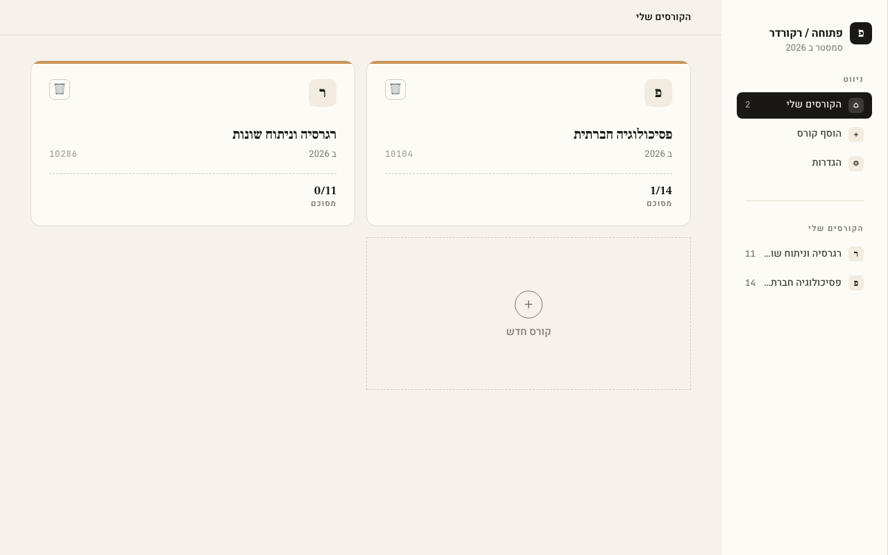

# Toolbox — open-uni recorder

> **Moved:** open-uni now lives in [omerAmrani/lecture-summarizer](https://github.com/omerAmrani/lecture-summarizer). The copy under `apps/open-uni/` is frozen and will be removed; open new issues and PRs there.

Detects new lectures on the Open University's OPAL platform, downloads and transcribes them, and generates summaries. Runs locally on your machine — no account, no login.



## Quick start

### 1. Install prerequisites

- Node.js 20+
- pnpm — `npm i -g pnpm`
- ffmpeg — `brew install ffmpeg`

### 2. Get your keys

- Open University login: username, password, ID number
- Groq API key (free tier) — for transcription → [get one](https://console.groq.com/keys "Create a key, then paste it into GROQ_API_KEY in apps/open-uni/api/.env")
- Gemini or Anthropic API key — for summaries (optional if you only want transcripts)
  - Gemini (has a free tier) → [get one](https://aistudio.google.com/app/apikey "Sign in with Google, create a key, then paste it into GEMINI_API_KEY in apps/open-uni/api/.env")
  - Anthropic (paid) → [get one](https://platform.claude.com/settings/keys "Create a key (needs billing set up), then paste it into ANTHROPIC_API_KEY in apps/open-uni/api/.env")

### 3. Install and configure

```bash
pnpm install                # also installs Playwright's Chromium
cp apps/open-uni/api/.env.example apps/open-uni/api/.env
```

Fill in `apps/open-uni/api/.env`:

```bash
OPENU_USERNAME=
OPENU_PASSWORD=
OPENU_ID=
GROQ_API_KEY=
GEMINI_API_KEY=             # and/or ANTHROPIC_API_KEY
```

### 4. Run

```bash
pnpm dev:open-uni
```

Open http://127.0.0.1:3002, go to **Settings**, and check that every key shows ✅. Then add a course by pasting its OPAL URL.

Full walkthrough with screenshots: [apps/open-uni/docs/user-guide.md](apps/open-uni/docs/user-guide.md)

## Features

- Detects new lectures from OPAL (Playwright, headless) — manual "check now" per class or for all classes
- Downloads lecture video and transcribes via Groq Whisper
- Summarizes transcripts via Gemini or Claude
- Versioned summaries per lecture

**Stack:** NestJS API (port 3001) + Next.js 15 web UI (port 3002), SQLite, no ORM

## Structure

```
apps/
  open-uni/
    api/                   NestJS API
    web/                   Next.js web UI
    tray/                  macOS tray app (Swift)
packages/
  config/                  Shared ESLint + tsconfig presets
  ui/                      Shared React components (stub)
```

## Commands

```bash
pnpm dev:open-uni                                  # start API + web
turbo run build --filter=@toolbox/<app-name>       # build one app
pnpm add <package> --filter=@toolbox/<app-name>    # add a dep to an app
```
