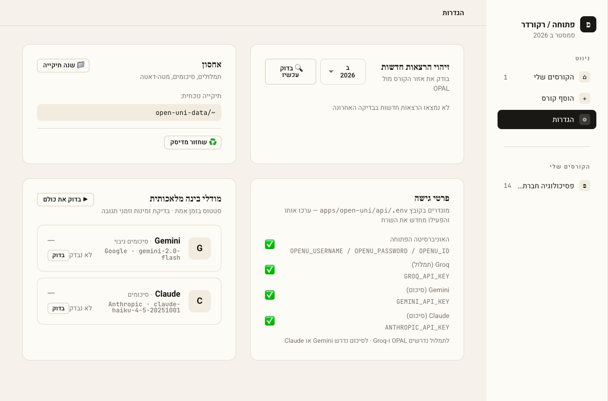
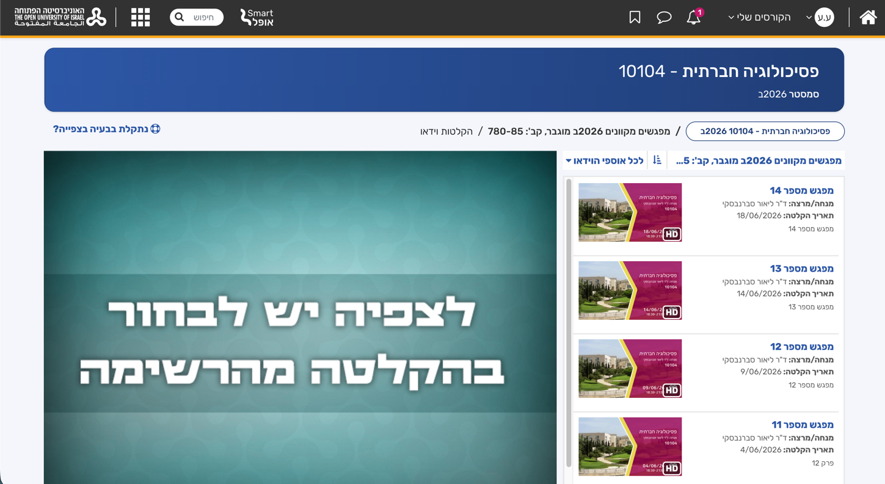
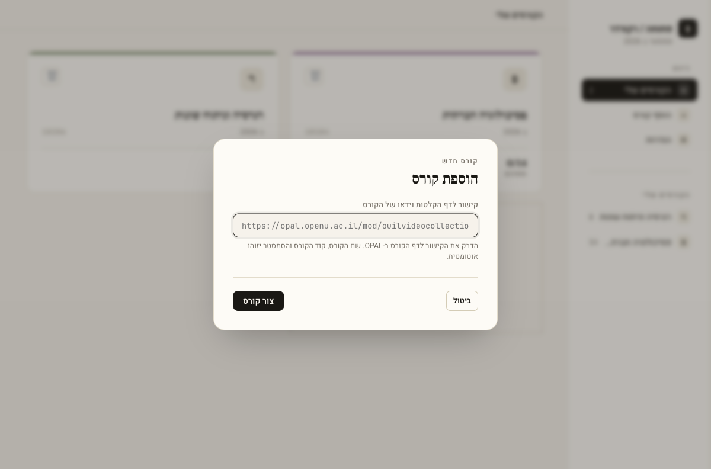
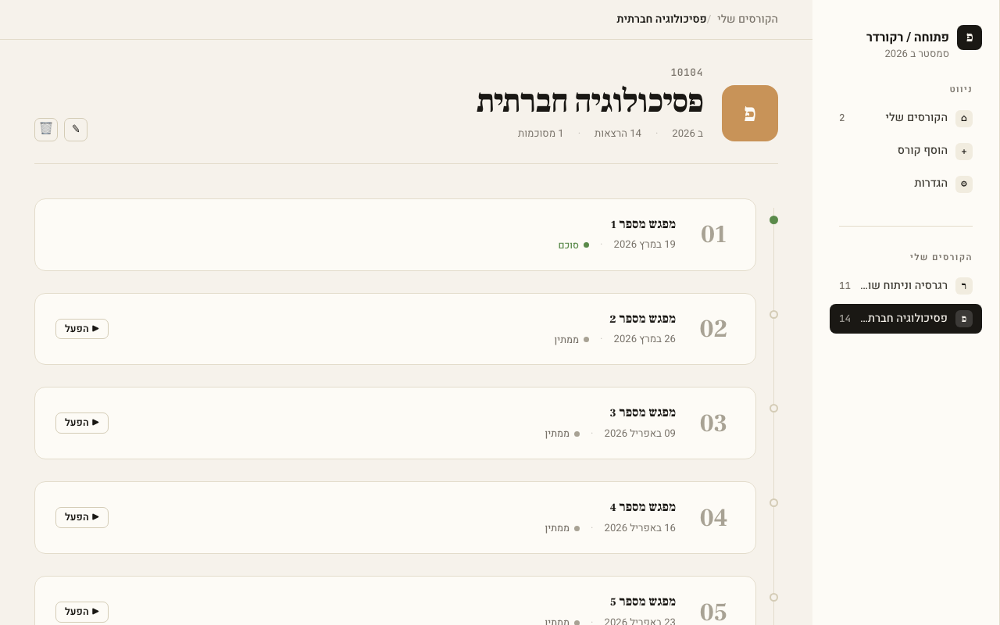
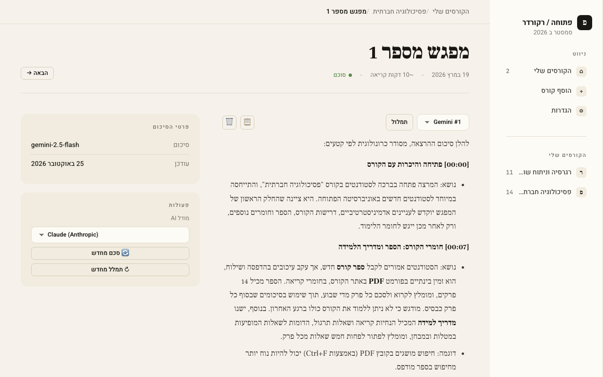

# open-uni recorder — User Guide

How to set up the app and use it to turn OPAL lectures into transcripts and summaries.

## 1. Setup (one time)

You need:

- Node.js 20+ and pnpm (`npm i -g pnpm`)
- ffmpeg (`brew install ffmpeg`)
- Your Open University login (username, password, ID number)
- A Groq API key (free) for transcription → [get one](https://console.groq.com/keys "Create a key, then paste it into GROQ_API_KEY in apps/open-uni/api/.env")
- A Gemini or Anthropic API key for summaries (optional if you only want transcripts)
  - Gemini (has a free tier) → [get one](https://aistudio.google.com/app/apikey "Sign in with Google, create a key, then paste it into GEMINI_API_KEY in apps/open-uni/api/.env")
  - Anthropic (paid) → [get one](https://platform.claude.com/settings/keys "Create a key (needs billing set up), then paste it into ANTHROPIC_API_KEY in apps/open-uni/api/.env")

From the repo root:

```bash
pnpm install                # also installs Playwright's Chromium
cp apps/open-uni/api/.env.example apps/open-uni/api/.env
```

Edit `apps/open-uni/api/.env`:

```bash
OPENU_USERNAME=...
OPENU_PASSWORD=...
OPENU_ID=...
GROQ_API_KEY=...
GEMINI_API_KEY=...          # and/or ANTHROPIC_API_KEY
```

Start the app:

```bash
pnpm dev:open-uni
```

Open http://127.0.0.1:3002. There's no login. The app runs only on your machine.

## 2. Check your keys

Go to **הגדרות** (Settings) in the sidebar. The **פרטי גישה** card shows a ✅ for each key the app found in `.env`. Transcribe and summarize buttons stay disabled until their keys are set. If you edit `.env`, restart the server.



Other things on this page:

- **בדוק עכשיו**: checks OPAL for new lectures in all your courses for the selected semester.
- **אחסון**: the folder where transcripts and summaries are saved. **שנה תיקייה** changes it, and **שחזור מדיסק** rebuilds the app's database from that folder.
- **מודלי בינה מלאכותית**: pings each AI model to check that it's available and how fast it responds.

## 3. Add a course

On OPAL, open the course's video recordings page (**הקלטות וידאו**) and copy its URL from the address bar. It looks like `https://opal.openu.ac.il/mod/ouilvideocollection/view.php?id=...`. Don't use the course home page: it has no recordings list, so the app would find 0 lectures.



Click **+ הוסף קורס** in the sidebar (or the **קורס חדש** card), paste the URL, and click **צור קורס**. The app opens the course page and looks for its lectures on OPAL (**מחפש הרצאות ב-OPAL…**). When it finishes, a message tells you how many it found. The lectures are added but not processed yet. If the search can't run, for example because another job is already running, the message says so. You can run it again later with **בדוק עכשיו** in Settings.



Your courses appear under **הקורסים שלי**, each with how many of its lectures are summarized:


## 4. Process lectures

Open a course to see its lectures. Each one shows a status (**ממתין** = waiting, **מתמלל...** = transcribing, **סוכם** = summarized, and so on). Click **▶ הפעל** on a lecture to download it, transcribe it, and summarize it.



## 5. Read the summary

Click a lecture to open it.

- The dropdown at the top switches between summary versions, and **תמלול** shows the raw transcript. 📋 copies what's on screen.
- **סכם עכשיו** summarizes a lecture that has a transcript but no summary yet.
- **פעולות** (Actions): choose an AI model, then **סכם מחדש** to make a new summary version (older versions are kept), or **תמלל מחדש** to transcribe again from scratch.
- **הבאה →** goes to the next lecture.



## Troubleshooting

- **A button is disabled**: a key is missing. Check Settings → פרטי גישה.
- **Ports already in use**: `pnpm dev:open-uni` stops whatever is using ports 3001/3002 before it starts.
- **Lost the database**: Settings → **שחזור מדיסק** rebuilds it from the storage folder.
